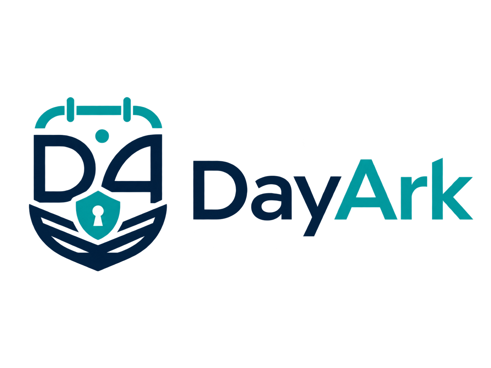

<p align="center">
  
</p>

<h1 align="center">DayArk</h1>
<p align="center"><strong>Plan it. Record it. Remember it. Keep it yours.</strong></p>
<p align="center">A free, open-source, local-first personal life companion built with Flutter.</p>
<p align="center">
  <a href="https://github.com/mujtabax18/dayark/releases">Download releases</a> ·
  <a href="CONTRIBUTING.md">Contribute</a> ·
  <a href="ROADMAP.md">Roadmap</a> ·
  <a href="WHY_DAYARK.md">Why I built it</a>
</p>

> **Open-source transition — v0.0.39:** DayArk started as my private project. I'm opening its source so people can inspect it, use it, learn from it, and improve it. This repository is being prepared for public release with a full Flutter project and an MIT license. Check [open-source readiness](OPEN_SOURCE_READINESS.md) before publishing binaries or making claims of verified builds.

## What is DayArk?

DayArk is an application for the small, practical things that make up a life: tasks, memories, people, finances, documents, routines and records. It is designed to work with information stored on **your own devices**, instead of requiring a subscription just to organize your day.

It is not one perfectly polished application. It is a collection of tools I kept building because I needed them. Some areas are more mature than others. My goal is to make those tools useful, reliable, and accessible to anyone who wants them.

### What is in the current code?

| Area | Features present in the supplied source |
| --- | --- |
| Daily life | Diary, habits, planning, chores/groceries, reminders, quotations, customizable home screens |
| Money and records | Expenses, loans/khata, invoices, meter records, reports |
| Life Archive | People, family relationships, connected life events, memories, photo albums, a visual relationship canvas |
| Media and documents | Media library/viewers, audio/video handling, scanner, PDF viewing/editing tools, linked memory albums and scanned documents |
| Privacy and portability | Local database using Drift/SQLite, password-protected portable backups, older-backup compatibility |
| Device connections | Local-network pairing and incremental synchronization, with TLS certificate pinning in the provided implementation |
| Personalization | Light/dark appearance and five accent presets: Indigo, Emerald, Ocean, Sunset and Rose |

**A feature appearing in the source is not a claim that every flow is bug-free or supported on every operating system.** Some features may need polish, real-device testing, or platform-specific dependencies. See [Open-source readiness](OPEN_SOURCE_READINESS.md).

## Life Archive: the feature closest to my heart

One of the newer features is **Life Archive**. I sometimes struggle to remember the names of people around me, and I wanted somewhere I could record who someone is, how we know each other, and the memories that connect us.

You can organize people and relationships, create visual connections, and add memories, albums and life events. I want this to become a place to remember the people and moments that matter—not just another address book.

## Why I am making DayArk open source

I began DayArk about **two years ago**, as a personal project. As AI development tools became available to me, I also used them to help build and improve it. I kept adding features whenever I thought, *this could make my own life easier.* Many of these features are things I actually use.

People around me weren't especially interested in using an app like this. That's okay. I still wanted to put it out into the world. If even one person finds it useful, or discovers a new possibility for Flutter by reading the code, that would make me happy.

I know some of the code is messy. The UI isn't where I want it to be. I'm a developer, not a designer, and this is a real personal project—not a polished product built by a large team. But it works for me, and I'd rather share something imperfect and useful than keep it hidden.

**I want people to be able to use their own devices fully, without needing subscriptions for every small tool.** I'm not against subscriptions or paid software. I simply believe there should be a free, local-first option too.

If this helps you and you'd like to help me, you can contribute in whatever way you can: fix a bug, improve a screen, test a feature, write documentation, suggest an idea, or just tell someone about it. I believe people make life better by helping each other.

Maybe nobody will ever read this far down my GitHub page. I'm writing it anyway. Maybe someone finds it someday. Maybe that's just a dream—but it's a dream I want to share.

**Thank you for being here. — @mujtabax18**

Read the longer note: [Why DayArk exists](WHY_DAYARK.md).

## Download and install

See the [latest GitHub release](https://github.com/mujtabax18/dayark/releases) for **actual available assets**. Recent releases supplied Android APKs and Linux AppImages; the existence of cross-platform source code does not mean that a signed installer is published for every platform.

**Android:** Download the official `DayArk.apk`, open it and approve installation from that source if Android asks. Install updates over the existing app with the same package ID and signing certificate. **Do not uninstall first**; local app data could be deleted.

**Linux:** Download the official `DayArk-x86_64.AppImage`, make it executable (`chmod +x DayArk-x86_64.AppImage`), and run it. AppImage compatibility depends on your distribution and system libraries.

**Before upgrading:** Make a DayArk backup and store a copy somewhere safe. If the release changes sync or database behavior, follow its migration instructions. Do not lose your backup password.

## Build from source

DayArk uses Flutter/Dart and the internal package import name **`metersystem`**. That legacy identifier is kept in the existing source for compatibility; changing it without planning can break imports or installed-app upgrade paths.

This source tree includes `pubspec.yaml`, required assets and native projects. Use Flutter **3.47.9** (see `.fvmrc`) and platform-specific build prerequisites:

```bash
git clone https://github.com/mujtabax18/dayark.git
cd dayark
flutter doctor
flutter pub get
flutter analyze
# Run on a configured, supported device, for example:
flutter run -d linux
```

For Android debug builds, run `flutter run -d <device-id>` on a configured device. Contributors **do not need the maintainer's Android signing keys** for debug mode. Android **release** builds need private signing files, described in [release automation](docs/RELEASE_AUTOMATION.md). This source has not been compiled in every target environment; see [OPEN_SOURCE_READINESS.md](OPEN_SOURCE_READINESS.md) for tested versus untested status.

### Build release packages and create a GitHub draft

DayArk includes one cross-platform Python script that can build a Linux/Windows desktop package, optionally build a signed Android APK on either host, and **optionally upload these to an unpublished GitHub draft**:

```bash
# Linux: asks whether to include Android, and optionally upload
python3 scripts/release.py

# Windows PowerShell (run on Windows)
py -3 scripts/release.py
```

Outputs go into `dist/v0.0.39/` and are intentionally excluded from Git. To create a draft in GitHub without building locally, use **Actions → Build DayArk draft release → Run workflow**. See the complete [free setup and GitHub Actions guide](docs/RELEASE_AUTOMATION.md). **Drafts are not publicly released or used by the in-app updater** until you manually publish them.

## How data and network access work

- **Local-first:** Core personal information is designed to live in the application's local database.
- **Backups:** Portable password-protected backup and restore paths are implemented. Keep a backup off-device; safeguard its password.
- **Local sync:** Device pairing and encrypted network synchronization are implemented for devices on a LAN. Pairing and version compatibility matter.
- **Optional online behavior:** Update checking and an online quotation library use the internet. Update checks may run at startup unless disabled in Settings. Don't interpret *local-first* as *never makes a network connection*.
- **Privacy and security:** Source visibility is valuable, but it is not a substitute for review and testing. Please report security issues privately; see [SECURITY.md](SECURITY.md).

**Never upload your personal database, backup file, diary entry, IDs, family photos, financial records, or passwords to a public GitHub issue.**

## What's next?

I'm especially interested in a **local AI assistant**, LAN chat with file sharing, local calling, a secure password manager, a simple Google Keep-style notepad, stronger task/alarm tools, better PDF and media tools, radio, faster performance, and better-looking themes and layouts. These are **ideas**, not promises or release dates. Some adjacent building blocks are already present.

See the [roadmap](ROADMAP.md) for the distinction between available features and proposed work.

## Contributing

You do not have to be an experienced Flutter developer to help. Bug reports, UI/UX work (especially welcome!), translations, accessibility improvements, performance profiling, documentation and tests are all useful.

Read [CONTRIBUTING.md](CONTRIBUTING.md), and open a discussion or issue before taking on a large redesign. Please respect people's private information when sharing reproductions or screenshots.

## License

The source in the new open-source release is proposed under the **MIT License**—see [LICENSE](LICENSE). MIT permits use, modification and redistribution, including commercial use, subject to its conditions. It does **not** require modified versions to remain open source. If that is not the intended policy, choose a different license **before publishing** and review the licenses of all included assets/dependencies.

Previous proprietary release notices referred to older distributions. The new source license applies to files the maintainer has authority to publish under it; it is not a grant of rights to independently owned third-party assets.

---

*Built with Flutter. Built for everyday life. Shared in the hope that it might help someone.*
